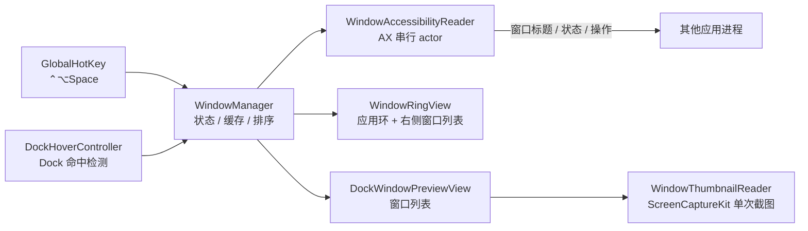

# MyMacTab

一个 macOS 窗口切换器：按住一个快捷键，在环形界面里按应用分组浏览所有窗口；或者直接把鼠标停在 Dock 图标上，弹出该应用的窗口列表。

纯 SwiftUI + AppKit 实现，无第三方依赖，不使用私有 API。

- **最低系统版本**：macOS 14 Sonoma
- **形态**：菜单栏常驻（`accessory`），不占用 Dock
- **权限**：辅助功能（必需）、屏幕录制（仅在开启缩略图时需要）

---

## 功能

### 窗口环

默认按 `⌃⌥Space` 呼出左侧应用环与右侧窗口列表，桌面背景保持可见。

- 使用紧凑的 860×520 点布局：左侧圆环直径 416 点，右侧列表宽 360 点；屏幕不足时等比缩小。
- 保留蓝色半透明圆环、应用图标、窗口数量角标与中心应用名称。
- 悬停或点击环形应用图标可切换应用，右侧同步显示对应窗口；也可使用快捷键。
- 环带整段可点：图标轨道两侧与图标之间的空隙都按角度选中最近的应用，不必精确点中图标。
- 指针在环上时可用滚轮（触控板双指滑动）切换应用，右侧列表内仍保留列表自身的滚动。
- 右侧显示应用标题、窗口数量、当前窗口位置和可滚动列表；悬停选中、点击打开。
- 列表支持键盘选择，选中行自动滚入可见区域，长标题可悬停查看。
- 点击圆环、列表与关闭按钮以外的透明区域会关闭界面。

### Dock 悬停预览

鼠标停在 Dock 图标上（默认 150ms）后，在该图标旁弹出窗口列表。

- 列表按最近使用排序，显示期间位置和宽度固定，不会因鼠标移动而跳动。
- 整行点击 = 当前前台窗口最小化，其他窗口打开/恢复；行内独立按钮可精确执行最小化/恢复与关闭。
- 支持直接输入文字筛选窗口标题，也支持 `↑` `↓` / `Tab` 选择、`↵` 打开、`Esc` 清空或退出。
- 出现原生菜单或名称气泡时自动避让，位置变化使用临界阻尼弹簧动画。
- 可在设置里按应用单独关闭预览，快捷键圆环不受影响。

### 原生 ⌘Tab 悬停预览

按 `⌘Tab` 呼出系统应用切换器，继续按住 `⌘`，将鼠标移到应用图标上即可查看窗口列表。

- 复用 Dock 的悬停延迟、应用排除、窗口操作与可选缩略图。
- 列表显示在切换器上方或下方，空间有限时缩短列表并滚动。
- 鼠标仍在原生图标上时，松开 `⌘` 或按 `Esc` 会收起预览，保留原生应用切换行为。
- 将鼠标移入预览浮窗即取消原生选择并保留列表；此时可松开 `⌘`，点击窗口、查看缩略图或使用搜索。
- 可在“设置 → 窗口预览”关闭“同时预览 ⌘Tab 中的应用”。

此入口依赖系统通过辅助功能公开的 `AXProcessSwitcherList` 和图标信息；无法识别时不按图标排列顺序猜测应用。不同 macOS 版本的原生切换器需要本机验证。

### 窗口缩略图（可选）

长悬停某个窗口条目（默认 450ms）后，在列表旁显示一张该窗口的画面。

- 使用 ScreenCaptureKit 的单次截图接口，不创建持续录屏流，不轮询，不写磁盘。
- 最小化窗口只显示 60 秒内的已有缓存，并标注“上次预览”。
- 未授予屏幕录制权限时显示明确占位，不影响窗口列表和窗口操作。
- 结果保存在 `NSCache`（8MB / 12 张上限），内存压力下可被系统提前回收。

### 窗口操作

- 聚焦 / 恢复指定窗口（先激活所属应用，再设为 focused/main 并 `AXRaise`）。
- 最小化 / 恢复（失败时回退到辅助功能的最小化按钮）。
- 关闭（通过目标窗口的 `AXCloseButton`，保留应用自己的未保存确认）。
- `⌥←` / `⌥→` 把当前窗口贴到屏幕左半或右半，自动避开菜单栏与 Dock。

---

## 快捷键

在 **设置 → 快捷键** 中点击按键区域，按下新组合即可保存；支持恢复默认。

| 默认快捷键 | 作用 |
| --- | --- |
| `⌃⌥Space` | 呼出 / 关闭窗口环（全局） |
| `←` `→` | 窗口环中切换应用 |
| 滚轮 / 双指滑动 | 窗口环中切换应用（指针在环上时） |
| `↑` `↓` | 切换当前应用的窗口 |
| `↵` | 打开选中窗口 |
| `Esc` | 关闭窗口环；在 Dock 列表中先清空筛选 |
| `⌥←` `⌥→` | 当前窗口左半屏 / 右半屏 |
| `⌘M` | 最小化 / 恢复选中窗口 |
| `⌘⌫` | 关闭选中窗口，保留原生保存确认 |
| `⌘F` | 编辑 Dock 列表筛选 |
| `Tab` / `⇧Tab` | Dock 列表中选择下一个 / 上一个窗口（备用） |
| `⌘,` / `⌘Q` | 菜单中打开设置 / 退出 |

窗口环、Dock 列表与菜单按作用域分别配置。全局呼出组合及菜单快捷键需要修饰键；同作用域或与全局呼出重复时拒绝保存。全局注册失败会在设置中显示错误。原生 `⌘Tab` 继续由系统管理，不在此重映射。

---

## 安装与运行

### 从 Xcode 运行

```sh
git clone git@github.com:tingfeng/my-mac-tab.git
cd my-mac-tab
open MyMacTab.xcodeproj
```

在 Xcode 里选择 `MyMacTab` scheme 和 `My Mac` 运行目标，`⌘R` 启动。

首次启动后需要在 **系统设置 → 隐私与安全性 → 辅助功能** 中勾选 MyMacTab；程序不会在启动或悬停时自动弹权限请求，只能在设置页点击「系统设置…」手动前往。

### 从命令行构建

```sh
xcodebuild -project MyMacTab.xcodeproj -scheme MyMacTab -configuration Release build
```

### 需要修改的地方

`MyMacTab.xcodeproj` 里登记的 bundle identifier 是 `tingfeng.MyMacTab`，签名方式为自动签名。用自己的开发者账号运行前，请在 **Signing & Capabilities** 中替换 Team 与 Bundle Identifier。

App Sandbox 是**关闭**的。沙盒会阻止读取和控制其他应用的窗口，这是本项目的功能前提，不要为“更规范”而打开它。

---

## 工作原理



几个关键设计：

- **AX 调用全部放在独立 actor 中串行执行**，每条消息 100ms 超时。目标应用无响应时不会阻塞主线程动画。
- **代次（generation）+ 任务取消**贯穿所有异步路径：窗口枚举、Dock 扫描、截图、窗口操作都带代次校验，旧结果无法覆盖新状态。
- **窗口身份用 `AXUIElement` 相等性复用**，不用数组下标，避免窗口关闭后名称、选中项乱跳。
- **无标题窗口不丢弃**，以「应用名 · 未命名窗口 N」显示，并通过元素身份保持编号稳定。
- **圆环显示期间冻结前后台排序**，避免 MyMacTab 自身被激活后图标重新排列。
- **几何参数集中在 `WindowRingGeometry` / `DockPreviewGeometry`**，绘制和点击命中复用同一套路径，修改尺寸不会出现“看得见点不到”。

性能上的一些取舍：窗口列表缓存 1 秒（空结果也缓存）、应用图标只保留一份 192px 位图、无窗口应用不保留图标、缩略图状态由独立 presenter 发布以免刷新整个列表、关闭浮层后保留轻量 NSPanel 但释放 SwiftUI 视图与材质。

---

## 项目结构

```
MyMacTab/
├── MyMacTab.xcodeproj/
└── MyMacTab/
    ├── MyMacTabApp.swift            菜单栏入口、AppDelegate、生命周期
    ├── GlobalHotKey.swift          Carbon 全局快捷键注册
    ├── WindowManager.swift         核心状态：缓存、排序、浮层、窗口操作
    ├── AccessibilityReader.swift   AX 批量读取、聚焦、最小化、关闭、分屏
    ├── WindowRingView.swift        应用环、右侧窗口列表与共享几何定义
    ├── DockHoverController.swift   Dock 位置扫描与图标命中
    ├── SwitcherKeyboardMonitor.swift 原生 ⌘Tab 的只读键盘观察与选择取消
    ├── WindowThumbnail.swift       缩略图读取、缓存与展示
    ├── PreviewPreferences.swift    UserDefaults 偏好设置
    ├── PreviewKeyboardMonitor.swift 列表可见期间的键盘事件拦截
    ├── PreviewSearchField.swift    基于 NSSearchField 的搜索框
    ├── AdaptiveWindowSurface.swift 玻璃材质与辅助显示设置适配
    ├── ContentView.swift           设置窗口（通用 / 窗口预览 / 应用）
    └── Assets.xcassets/            应用图标（10 个槽位，16–1024px）
```

所有 Swift 源文件平铺在 `MyMacTab/` 下；`ShortcutConfiguration.swift` 集中管理快捷键持久化、录入与冲突检查。

---

## 开发与校验

项目根目录可以直接做 Swift 类型校验，不需要打开 Xcode：

```sh
swiftc -typecheck -default-isolation MainActor \
  -module-cache-path /tmp/MyMacTab-swift-module-cache \
  -sdk /Applications/Xcode.app/Contents/Developer/Platforms/MacOSX.platform/Developer/SDKs/MacOSX.sdk \
  -target arm64-apple-macosx14.0 \
  MyMacTab/*.swift
```

类型校验通过不代表界面正确。涉及鼠标、焦点、截图的改动需要在真机上验证，重点检查：应用环与列表是否完整、悬停时位置是否稳定、点击列表能打开而点击透明间隙能关闭、输入法候选词与键盘滚动、关闭未保存文档的确认流程、多屏边缘，以及系统「减少动态效果 / 降低透明度」开启后的表现。

更细的实现约定和踩坑记录见 [`Docs/维护说明.md`](Docs/维护说明.md)。

---

## 已知限制

- macOS 没有公开 API 能可靠枚举和切换所有 Spaces。聚焦其他桌面的窗口会交由系统切换 Space，结果取决于目标应用与系统当前状态。
- 部分应用不暴露标准 AX window，受保护内容（如 DRM 视频）也可能无法读取或截图。
- 窗口使用顺序只存在内存中，重启后按系统返回的顺序和最近使用重新累积。
- 截图对应的窗口匹配依赖 PID、AX 几何和标题；对应关系含糊时宁可不显示，也不会显示成另一个窗口。
- 原生 `⌘Tab` 由 macOS 管理；应用自己的快捷键可在设置中自定义。

---

## 许可证

仓库当前未包含开源许可证文件。如需引用、分发或商用，请先与作者联系。
